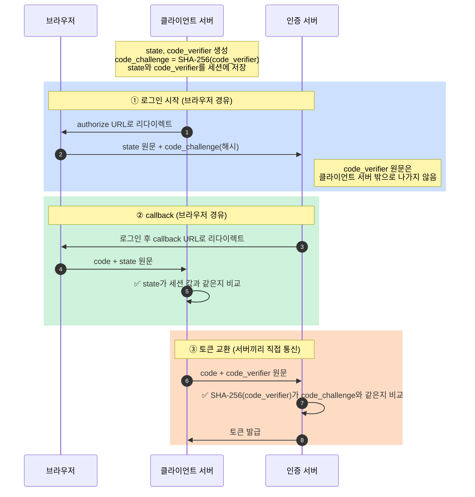

# OAuth state와 code_verifier: 무엇이 다르고 각각 무엇을 막는가

state와 code_verifier는 둘 다 "로그인할 때마다 클라이언트가 새로 만드는 난수"라서 같은 목적처럼 보인다. 하지만 **막는 공격, 검사하는 쪽, 검사 시점이 모두 다르다.** 이 문서는 두 서비스 사이의 계정 연동(account linking)을 검토하면서 헷갈렸던 지점을 따로 정리한 것이다. 흐름 전체와 각 값의 생성 규칙은 [[oauth2-oauth21-oidc-primer]]의 7.2절(state), 7.3절(PKCE), 9.4절(nonce)에 있다.

## 한 줄 요약

| 값 | 막는 것 | 결과적으로 지키는 것 |
| --- | --- | --- |
| **state** | 공격자가 **자기 계정의 로그인 결과**를 피해자 브라우저에 밀어 넣는 것 | 피해자가 모르는 사이에 공격자 계정에 연결되는 것 |
| **code_verifier** | 공격자가 **피해자의 code를 가로채** 토큰으로 바꾸는 것 | 공격자가 피해자의 토큰을 손에 넣어 피해자 행세를 하는 것 |

방향으로 기억하면 쉽다.

```
state          : 공격자의 것 ──▶ 피해자에게 밀어 넣기   를 막음
code_verifier  : 피해자의 것 ──▶ 공격자가 빼앗기        를 막음
```

---

## 1. 두 값이 어디로 가고 누가 검사하나

Authorization Code + PKCE 흐름에는 브라우저를 거치는 구간과 서버끼리 직접 통신하는 구간이 있다. 두 값은 이 구간을 서로 다르게 지나간다.



| 구분 | state | code_verifier |
| --- | --- | --- |
| 만드는 쪽 | 클라이언트 서버 | 클라이언트 서버 |
| 브라우저에 노출 | 원문이 노출됨 | 해시(code_challenge)만 노출되고, 원문은 서버 사이에서만 오감 |
| 검사하는 쪽 | **클라이언트** | **인증 서버** |
| 검사 시점 | callback | 토큰 교환 |
| 막는 공격 | 남이 시작한 로그인 결과를 내 브라우저에 밀어 넣기 (CSRF) | 가로챈 code로 토큰 받기 (code 가로채기, code injection) |

---

## 2. 계정 연동에 대입한 공격 시나리오

예시 구성은 다음과 같다. 두 서비스가 등장한다.

- **클라이언트 앱**: 계정 연결을 시작하는 쪽. 이 앱의 서버가 OAuth 클라이언트 역할을 한다.
- **ID 제공자(Identity Provider, IdP)**: 회원 계정을 가지고 있고 인증 서버(Authorization Server)를 운영하는 쪽.

연동이 끝나면 "클라이언트 앱 사용자 ↔ IdP 회원" 연결이 만들어진다.

### 2.1 state가 막는 공격: 남의 계정에 연결되기

1. 공격자가 자기 클라이언트 앱 세션에서 계정 연결을 시작하고, **자기 IdP 계정**으로 로그인해 code를 받는다. callback으로 가기 직전에 멈춘다.
2. 그 callback URL(`https://client.example/callback?code=<공격자의 code>&state=…`)을 피해자가 열도록 유도한다.
3. state 검사가 없으면 피해자의 클라이언트 앱 계정이 **공격자의 IdP 계정에 연결된다.**
4. 그 뒤 피해자가 클라이언트 앱에 입력하는 내용이 공격자 계정에 쌓인다. 공격자는 IdP 서비스에 직접 로그인해 그 내용을 본다.

state가 있으면 3번에서 막힌다. 피해자 세션에는 그 state가 저장되어 있지 않으므로 클라이언트가 요청을 거부한다.

### 2.2 code_verifier가 막는 공격: 가로챈 code로 토큰 받기

callback URL에 실린 code가 로그, Referer 헤더, 같은 기기의 악성 앱 등으로 새어 나갔다고 하자. 공격자가 그 code로 인증 서버에 토큰을 요청해도 **code_verifier 원문이 없으므로** 인증 서버가 거부한다. 원문은 브라우저를 한 번도 거치지 않았고, URL에 노출된 code_challenge는 SHA-256 해시라서 거꾸로 원문을 계산할 수 없다.

---

## 3. 왜 state를 CSRF 방어라고 부르나

### 3.1 CSRF는 세션을 빼앗는 공격이 아니다

흔한 오해는 "CSRF는 쿠키를 이용해 공격자가 사용자 세션을 빼앗는 공격"이라는 것이다. 실제로 CSRF는 세션에 **올라타는** 공격이다. 공격자는 쿠키를 보지도 가져가지도 못한다. 대신 피해자의 브라우저가 공격자가 만든 요청을 보내게 하고, 브라우저가 그 요청에 **피해자의 쿠키를 자동으로 붙이는 성질**을 이용한다.

| 구분 | CSRF (Cross-Site Request Forgery, 요청 위조) | 세션 탈취 (Session Hijacking) |
| --- | --- | --- |
| 공격자가 쿠키를 얻나 | ❌ 얻지 못함 | ✅ 쿠키 값을 빼냄 (예: XSS로 `document.cookie` 탈취) |
| 요청을 보내는 쪽 | **피해자의 브라우저** | 공격자 자신 |
| 핵심 원리 | 브라우저가 쿠키를 자동으로 붙이는 성질 | 훔친 쿠키로 피해자 행세 |
| 대표적인 방어 | CSRF 토큰, SameSite 쿠키 | HttpOnly 쿠키, XSS 방어 |

### 3.2 OAuth callback 위조는 전형적인 CSRF와 구조가 같다

```
[전형적인 CSRF: 송금]
공격자 사이트의 숨은 폼 ──▶ 피해자 브라우저가 POST bank.com/transfer?to=공격자
                          + 피해자의 bank.com 쿠키가 자동으로 붙음
                          → 은행은 "피해자가 송금을 요청했다"고 처리

[OAuth callback CSRF: 계정 연결]
공격자가 보낸 링크 ──▶ 피해자 브라우저가 GET client.example/callback?code=<공격자의 code>
                     + 피해자의 클라이언트 앱 세션 쿠키가 자동으로 붙음
                     → 클라이언트 앱은 "피해자가 이 IdP 계정으로 연결을 마쳤다"고 처리
```

| CSRF의 구성 요소 | 송금 예시 | OAuth callback |
| --- | --- | --- |
| 공격자가 만든 요청 | 송금 폼 | 공격자의 code를 담은 callback URL |
| 자동으로 붙는 피해자 쿠키 | bank.com 세션 | 클라이언트 앱 세션 (callback에서 "어느 사용자인가"를 정하는 바로 그 쿠키) |
| 서버가 실행하는 동작 | 피해자 계좌에서 송금 | 피해자의 클라이언트 앱 계정을 공격자의 IdP 계정에 연결 |

OAuth 표준(RFC 6749 10.12절)도 이 공격을 "Cross-Site Request Forgery"라는 이름으로 다룬다.

### 3.3 state가 막는 원리는 CSRF 토큰과 같다

폼의 CSRF 토큰은 서버가 세션마다 예측할 수 없는 값을 심어 두고, 요청이 들어오면 그 값이 세션 값과 같은지 확인하는 방식이다. 공격자는 피해자 세션의 토큰을 모르므로 유효한 요청을 만들 수 없다.

state도 똑같이 동작한다.

1. 로그인을 시작할 때 클라이언트가 난수 state를 만들어 **사용자 자신의 세션**에 저장한다.
2. callback에서 쿼리의 state가 세션 값과 같은지 확인한다.
3. 공격자의 callback URL에는 **공격자 세션의 state**가 들어 있으므로 피해자 세션 값과 맞지 않아 거부된다.

그래서 state는 "OAuth 흐름 안에서 쓰이는 CSRF 토큰"이다. 값을 보내기만 하고 세션과 대조하지 않으면 아무것도 막지 못한다.

---

## 4. "같은 목적 아닌가"라는 직관에도 근거는 있다

PKCE는 CSRF도 **부수적으로** 막는다. 2.1절 시나리오에서 공격자의 code는 **공격자 세션의 code_verifier**에 묶여 있다. 피해자 세션의 클라이언트가 자기 code_verifier로 토큰 교환을 시도하면 해시가 맞지 않아 인증 서버가 거부한다. 그래서 OAuth 보안 모범 사례(RFC 9700)와 OAuth 2.1 초안은, 인증 서버가 PKCE를 지원한다는 것을 확인한 클라이언트라면 CSRF 방어를 PKCE에 맡겨도 된다고 허용한다. OIDC 흐름에서는 nonce 검증도 같은 효과를 낸다.

그래도 state를 함께 쓰는 것이 가장 단순하고 확실하다. 특히 아래처럼 state에 다른 역할까지 실린 연동에서는 뺄 수 없다.

---

## 5. 사례: state가 세 번째 역할을 맡는 경우

표준 OAuth에서 state는 **클라이언트만을 위한 값**이다. 인증 서버는 해석하지 않고 받은 그대로 돌려준다. 그런데 일부 제휴사 연동 규격에서는 state가 **IdP 쪽 서버가 "누가 연결을 요청했는지" 조회하는 키**로도 쓰인다.

```
클라이언트 앱이 state 발급 ──▶ 인증 서버가 로그인·가입 동안 보관 ──▶ IdP 서버가
                                                               GET https://client.example/api/relay/info?state=
                                                               → 연결을 시작한 클라이언트 앱 사용자 식별자(sub) 획득
```

| state의 역할 | 표준 OAuth | 이 연동 |
| --- | --- | --- |
| CSRF 방어 | ✅ | ✅ |
| 연결을 요청한 클라이언트 앱 사용자 조회 | ❌ | ✅ 규격 고유의 용도 |

이 구조에서는 두 가지 제약이 생긴다.

- 인증 서버가 로그인, 가입, 이메일 인증 화면을 전환하는 동안 state를 잃지 않아야 한다.
- 조회 키로서의 state에는 유효시간(예: 발급 후 10분)이 있다. 가입과 인증에 그보다 오래 걸리면 조회가 실패한다.

조회 요청에 붙는 토큰은 사용자 토큰이 아니라 **조회하는 서버 자신의 토큰**(Client Credentials로 발급)이다. "어느 사용자인가"는 토큰이 아니라 state가 알려 준다. 토큰은 출입증이고, state는 접수번호인 셈이다.

---

## 6. 함께 쓰이는 nonce와의 구분

| 구분 | state | code_verifier | nonce |
| --- | --- | --- | --- |
| 소속 표준 | OAuth (RFC 6749) | PKCE (RFC 7636) | OpenID Connect |
| 검사하는 쪽 | 클라이언트 | 인증 서버 | 클라이언트 |
| 검사 시점 | callback | 토큰 교환 | id_token 검증 |
| 돌아오는 곳 | redirect URL 쿼리 | (돌아오지 않음, 해시로 대조) | id_token 안 |
| 막는 것 | 남의 로그인 결과를 내 세션에 밀어 넣기 | 가로챈 code로 토큰 받기 | 예전 id_token을 다시 쓰기 |

세 값 모두 **암호학적 난수 생성기**로 로그인마다 새로 만들고, 한 번 쓰면 버린다.

## 참고

- RFC 6749 10.12절: Cross-Site Request Forgery
- RFC 7636: Proof Key for Code Exchange (PKCE)
- RFC 9700: Best Current Practice for OAuth 2.0 Security
- [[oauth2-oauth21-oidc-primer]] 7.2절, 7.3절, 9.4절, 16장
